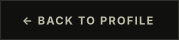
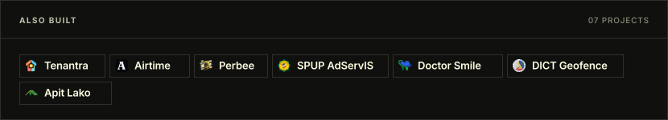

<!-- Generated by scripts/write-readme.py -->

  <a href="https://github.com/kenjivafe"><picture><source media="(prefers-color-scheme: light)" srcset="./assets/btn-back-light.svg" /></picture></a>

  <picture><source media="(prefers-color-scheme: light) and (max-width: 600px)" srcset="./assets/more-m-light.svg" /><source media="(prefers-color-scheme: light)" srcset="./assets/more-light.svg" /><source media="(max-width: 600px)" srcset="./assets/more-m-dark.svg" /></picture>

