<!-- Generated: cards by scripts/build-stats.mjs (edit CONTENT there), this file by scripts/write-readme.py -->

  <picture><source media="(prefers-color-scheme: light) and (max-width: 600px)" srcset="./assets/hero-m-light.svg" /><source media="(prefers-color-scheme: light)" srcset="./assets/hero-light.svg" /><source media="(max-width: 600px)" srcset="./assets/hero-m-dark.svg" />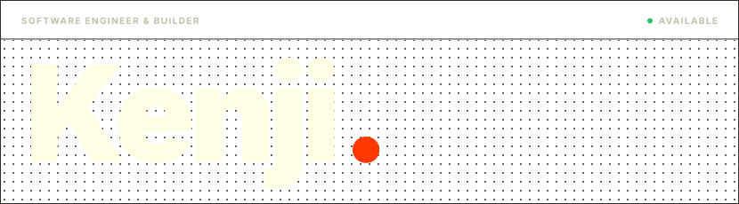</picture>

  <picture><source media="(prefers-color-scheme: light) and (max-width: 600px)" srcset="./assets/about-m-light.svg" /><source media="(prefers-color-scheme: light)" srcset="./assets/about-light.svg" /><source media="(max-width: 600px)" srcset="./assets/about-m-dark.svg" />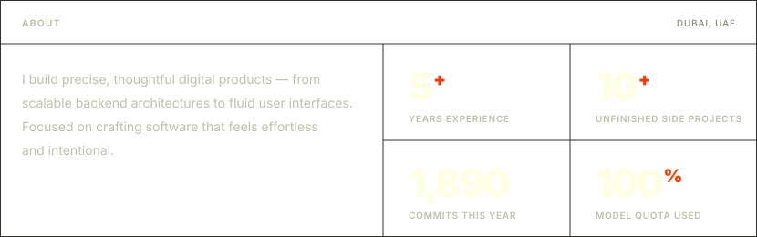</picture>

  <a href="https://kenjivafe.vercel.app"><picture><source media="(prefers-color-scheme: light)" srcset="./assets/btn-portfolio-light.svg" />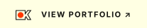</picture></a>
  <a href="https://linkedin.com/in/kenji-von-ashley"><picture><source media="(prefers-color-scheme: light)" srcset="./assets/btn-linkedin-light.svg" /></picture></a>
  <a href="mailto:kenjivafe@gmail.com"><picture><source media="(prefers-color-scheme: light)" srcset="./assets/btn-email-light.svg" /></picture></a>

  <a href="https://rigko.com"><picture><source media="(prefers-color-scheme: light) and (max-width: 600px)" srcset="./assets/work-1-m-light.svg" /><source media="(prefers-color-scheme: light)" srcset="./assets/work-1-light.svg" /><source media="(max-width: 600px)" srcset="./assets/work-1-m-dark.svg" />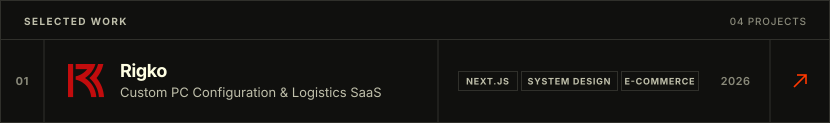</picture></a>
  <a href="https://gymcentrix.vercel.app"><picture><source media="(prefers-color-scheme: light) and (max-width: 600px)" srcset="./assets/work-2-m-light.svg" /><source media="(prefers-color-scheme: light)" srcset="./assets/work-2-light.svg" /><source media="(max-width: 600px)" srcset="./assets/work-2-m-dark.svg" />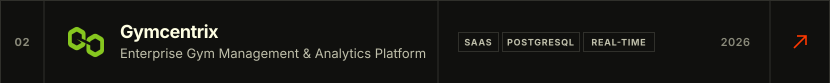</picture></a>
  <a href="https://gritdp.com"><picture><source media="(prefers-color-scheme: light) and (max-width: 600px)" srcset="./assets/work-3-m-light.svg" /><source media="(prefers-color-scheme: light)" srcset="./assets/work-3-light.svg" /><source media="(max-width: 600px)" srcset="./assets/work-3-m-dark.svg" />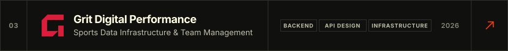</picture></a>
  <a href="https://resq-link-kappa.vercel.app"><picture><source media="(prefers-color-scheme: light) and (max-width: 600px)" srcset="./assets/work-4-m-light.svg" /><source media="(prefers-color-scheme: light)" srcset="./assets/work-4-light.svg" /><source media="(max-width: 600px)" srcset="./assets/work-4-m-dark.svg" />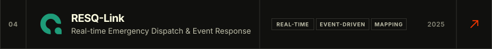</picture></a>

  <a href="https://github.com/kenjivafe/kenjivafe/blob/main/PROJECTS.md"><picture><source media="(prefers-color-scheme: light)" srcset="./assets/btn-more-light.svg" />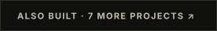</picture></a>

  <picture><source media="(prefers-color-scheme: light) and (max-width: 600px)" srcset="./assets/experience-m-light.svg" /><source media="(prefers-color-scheme: light)" srcset="./assets/experience-light.svg" /><source media="(max-width: 600px)" srcset="./assets/experience-m-dark.svg" />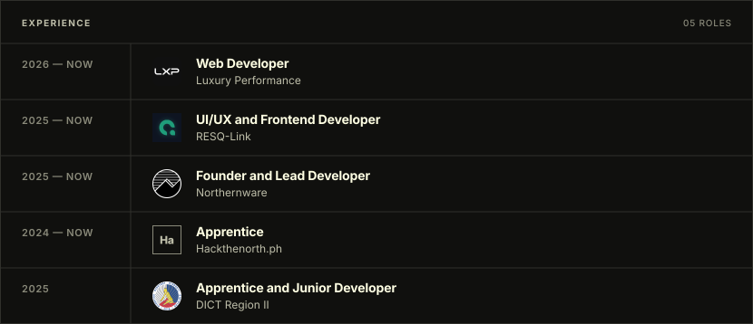</picture>

  <picture><source media="(prefers-color-scheme: light) and (max-width: 600px)" srcset="./assets/capabilities-m-light.svg" /><source media="(prefers-color-scheme: light)" srcset="./assets/capabilities-light.svg" /><source media="(max-width: 600px)" srcset="./assets/capabilities-m-dark.svg" />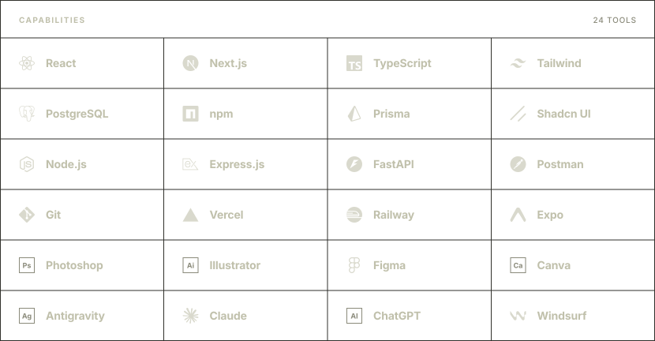</picture>

  <picture><source media="(prefers-color-scheme: light) and (max-width: 600px)" srcset="./assets/activity-m-light.svg" /><source media="(prefers-color-scheme: light)" srcset="./assets/activity-light.svg" /><source media="(max-width: 600px)" srcset="./assets/activity-m-dark.svg" />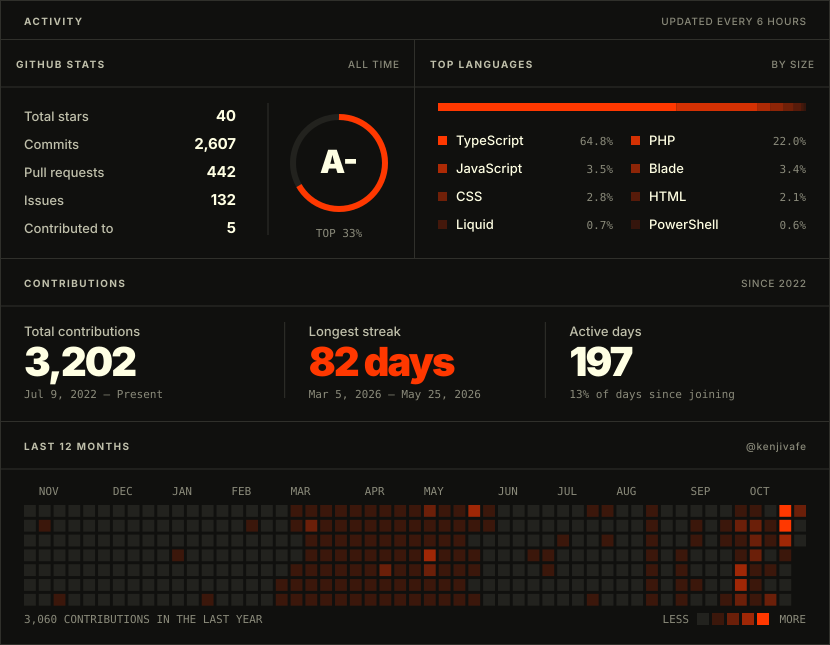</picture>

  <a href="mailto:kenjivafe@gmail.com"><picture><source media="(prefers-color-scheme: light) and (max-width: 600px)" srcset="./assets/contact-m-light.svg" /><source media="(prefers-color-scheme: light)" srcset="./assets/contact-light.svg" /><source media="(max-width: 600px)" srcset="./assets/contact-m-dark.svg" />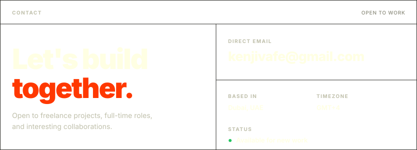</picture></a>

  <picture><source media="(prefers-color-scheme: light) and (max-width: 600px)" srcset="./assets/footer-m-light.svg" /><source media="(prefers-color-scheme: light)" srcset="./assets/footer-light.svg" /><source media="(max-width: 600px)" srcset="./assets/footer-m-dark.svg" />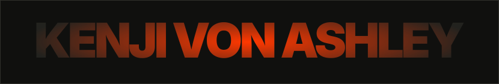</picture>

